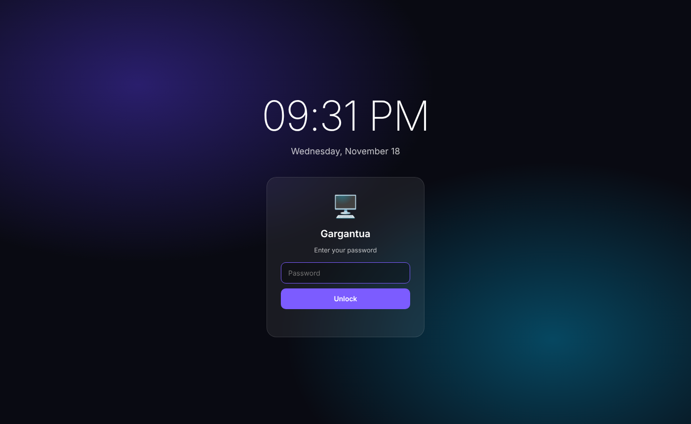
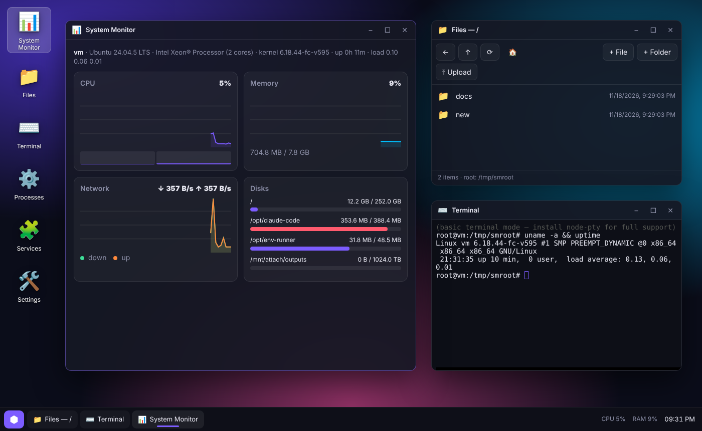

# ServerManager++

**A web-based desktop OS for your home server.** Open it from any browser (PC, phone, tablet) and you get a real desktop with windows, a taskbar, a start menu and apps to manage the machine.

> The successor of [MCServerManager++](https://github.com/YvzSlmDrms54/MCServerManagerPP). That one was for Minecraft servers; this one is for *any* server.




## Features

| App | What it does |
|---|---|
| 📊 **System Monitor** | Live CPU (per core), RAM, swap, disks, network graphs, temperature, uptime |
| 📁 **Files** | Browse, create, rename, delete, upload (drag & drop), download, open in terminal |
| 📝 **Text Editor** | Edit config files right in the browser (`Ctrl+S` to save) |
| ⌨️ **Terminal** | A real shell on the server via xterm.js (`Alt+T`) |
| ⚙️ **Processes** | Sort/filter running processes, end them |
| 🧩 **Services** | Start / stop / restart systemd services, read their logs |
| 🛠️ **Settings** | Server name, dark/light theme, wallpapers, accent color, files root, password |

The desktop itself has a boot screen, a lock screen with a password, draggable/resizable windows (minimize, maximize, close), a taskbar with a CPU/RAM tray, a searchable start menu, toasts and right-click menus. It works on phones as well.

## Install

Requires **Node.js 18+**.

```bash
git clone https://github.com/YvzSlmDrms54/ServerManagerPP.git
cd ServerManagerPP
npm install
npm start
```

Open `http://<server-ip>:5454`. On the first visit you choose the admin password.

### Full terminal support (recommended)

The terminal works out of the box in basic mode. For full support (live resizing, `htop`, `nano`, `vim`…) install the build tools before `npm install` so the optional `node-pty` module can compile:

```bash
sudo apt install -y build-essential python3
npm install
```

### Run it as a service (starts on boot)

```bash
sudo ./scripts/install-service.sh
```

This creates a `servermanagerpp` systemd service. Run it as root if you want to control services and kill any process from the UI. Otherwise it runs as your user and those actions need root.

## Configuration

Settings live in `data/config.json` (created on first run). Environment variables override them:

| Variable | Default | Meaning |
|---|---|---|
| `PORT` | `5454` | Web port |
| `HOST` | `0.0.0.0` | Bind address (`127.0.0.1` = local only) |
| `FILES_ROOT` | your home folder | Where Files and Terminal start. Files can't leave this folder |
| `SMPP_PASSWORD` | — | Sets the admin password on first start (skips the setup screen) |
| `SMPP_DATA` | `./data` | Where the config is stored |

## Adding your own app

Every app is one file in `public/apps/`. Create `public/apps/hello.js`:

```js
SMPP.registerApp({
  id: 'hello', name: 'Hello', icon: '👋', width: 400, height: 300,
  description: 'My first app',
  mount(body, win) {
    body.innerHTML = '<div class="pad">Hello from ServerManager++!</div>';
    win.onClose(() => console.log('bye'));
  }
});
```

Then add `<script src="/apps/hello.js"></script>` to `public/index.html`. It shows up on the desktop and in the start menu. Helpers available: `SMPP.api()`, `SMPP.toast()`, `SMPP.confirm()`, `SMPP.prompt()`, `SMPP.stats.subscribe()`, `SMPP.socket`, `SMPP.wm.open()`.

## Security

ServerManager++ gives full control of the machine (including a shell), so:

- Use a **strong password**. Login is rate-limited (5 tries / 5 minutes).
- Keep it on your **local network**. Don't port-forward it to the internet. For remote access use a VPN such as Tailscale or WireGuard.
- Sessions are HttpOnly + SameSite=Strict cookies, passwords are hashed with scrypt.

## Project structure

```
server/
  index.js        entry: express + socket.io
  auth.js         password, sessions, rate limit
  config.js       data/config.json
  terminal.js     node-pty / script fallback
  routes/         system, files, processes, services, settings
public/
  index.html
  css/os.css
  js/core.js      api, stats bus, dialogs, graphs
  js/wm.js        window manager
  js/main.js      boot, lock screen, desktop, start menu
  apps/*.js       one file per app
```

## License

MIT © Yavuz Selim, mybetasoft / 54Gamez
